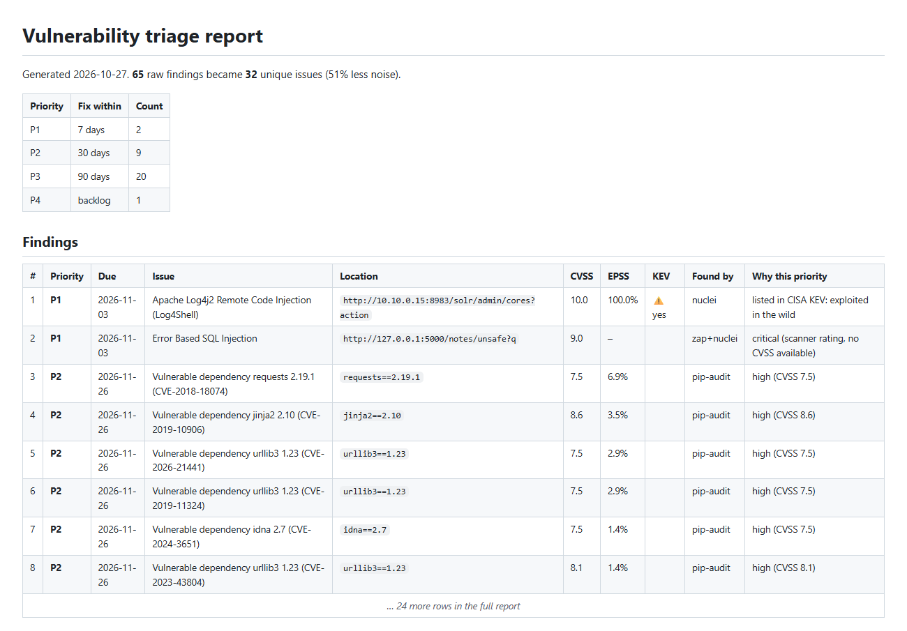

# vulntriage

[](https://github.com/Uppula4070/vuln-triage-automation/actions/workflows/ci.yml)

A command-line tool that takes raw output from **Semgrep, OWASP ZAP, Nuclei and pip-audit**, merges duplicates within and across tools, adds real-world risk data (**CVSS** from OSV, **EPSS**, **CISA KEV**), and produces a ranked P1–P4 fix list with due dates, plus ready-to-file Jira tickets.

Security teams lose hours triaging the same issue reported five different ways. This tool does that first pass in seconds, and explains every priority it assigns.

```
$ vulntriage --semgrep semgrep.json --zap zap.json --nuclei nuclei.jsonl --pip-audit pip-audit.json -o report.md

65 raw findings -> 32 unique  |  P1: 2  P2: 9  P3: 20  P4: 1
  P1  Apache Log4j2 Remote Code Injection (Log4Shell)         listed in CISA KEV: exploited in the wild
  P1  Error Based SQL Injection                               critical (scanner rating, no CVSS available)
  P2  Vulnerable dependency requests 2.19.1 (CVE-2018-18074)  high (CVSS 7.5)
  P2  Vulnerable dependency jinja2 2.10 (CVE-2019-10906)      high (CVSS 8.6)
  P2  Vulnerable dependency urllib3 1.23 (CVE-2026-21441)     high (CVSS 7.5)
```



**→ See the full [sample report](docs/sample-report.md)** and the [Jira payloads](docs/sample-jira-issues.json) it generated.

## How it works

```
 semgrep.json ─┐
 zap.json ─────┤   1. Parse        every tool's format -> one Finding model
 nuclei.jsonl ─┼─► 2. De-duplicate same weakness + same place = one issue
 pip-audit ────┘   3. Enrich       CVSS vector (OSV) · EPSS score · CISA KEV listing
                   4. Prioritize   P1-P4 with a written reason and a due date
                   5. Output       Markdown · CSV · JSON · Jira issues · CI exit code
```

### 1. De-duplication rules

| Kind | Two findings are the same issue when they share… | Example from the sample data |
|---|---|---|
| Code | CWE + file + line | Two Semgrep rules both flag the SQL string on `app/app.py:98` |
| Web | CWE + host + path + **parameter names** (values ignored) | ZAP's `?q=test` and Nuclei's `?q=%27` on `/notes/unsafe` → one SQL injection, found by both |
| Web, no parameter | CWE + host | A missing header reported on 4 URLs is one site-wide fix, not 4 tickets |
| Dependency | package + version + CVE (PYSEC/GHSA aliases collapse) | pip-audit lists `PYSEC-2018-28` twice → one issue |

When findings merge, the tool keeps the highest severity, unions the CVEs, and records which tools agreed. Agreement between two independent tools is a strong signal that a finding is real.

### 2. Prioritization: exploitation evidence first, severity second

CVSS measures how bad a flaw *would be*. EPSS and CISA KEV measure how likely it is to *actually be used* against you. That is why a "medium" CVE that is being exploited today outranks a "critical" one with no known exploit.

| Priority | Fix within | Rule (first match wins) |
|---|---|---|
| **P1** | 7 days | In CISA KEV · or EPSS ≥ 50% · or CVSS ≥ 9.0 |
| **P2** | 30 days | CVSS ≥ 7.0 · or EPSS ≥ 10% |
| **P3** | 90 days | CVSS ≥ 4.0 |
| **P4** | backlog | everything else |

Findings without a CVE (custom code bugs, misconfigurations) have no EPSS or KEV data, so they use the CVSS-equivalent of the scanner's own rating. The report says so in the "why" column, so nobody mistakes a guess for a measurement.

### 3. CVSS calculator

`cvss.py` implements the CVSS v3.1 base score formula from the FIRST specification, including the spec's floating-point-safe rounding. It is tested against NVD scores for known CVEs (Log4Shell = 10.0, CVE-2018-18074 = 7.5, and others).

## Usage

```bash
pip install git+https://github.com/Uppula4070/vuln-triage-automation.git

vulntriage --semgrep semgrep.json --zap zap-report.json \
           --nuclei nuclei.jsonl --pip-audit pip-audit.json \
           -o report.md --csv report.csv --json report.json
```

| Option | What it does |
|---|---|
| `--semgrep / --zap / --nuclei / --pip-audit FILE` | Scanner output (repeatable). Use `semgrep --json`, ZAP's JSON report, `nuclei -jsonl`, `pip-audit -f json` |
| `-o / --csv / --json FILE` | Report formats |
| `--jira-project KEY` | Build Jira issues for every P1/P2 (dry run: saved to `jira-issues.json`) |
| `--jira-create` | Actually create them. Needs `JIRA_URL` (https only), `JIRA_EMAIL`, `JIRA_API_TOKEN` |
| `--fail-on P1` | Exit with code 1 if anything is P1 (or the level you pick). Use it as a CI gate |
| `--offline-data DIR` | Use saved KEV/EPSS/OSV files instead of live APIs (air-gapped runs, tests) |
| `--no-enrich` | Skip all lookups |

### As a CI gate

```yaml
- run: vulntriage --semgrep semgrep.json --pip-audit audit.json --fail-on P1 -o report.md
```

This repo's own [CI](.github/workflows/ci.yml) runs the tool on the sample scans with live data on every push and posts the report to the job summary.

## Engineering notes

- **No third-party runtime dependencies.** Standard library only, so it is easy to audit and has no supply chain to patch.
- **Network failures never break a run.** A failed KEV/EPSS/OSV lookup prints a warning and the finding keeps its scanner rating.
- **HTTPS enforced** for every outbound request, so the Jira API token is never sent in clear text.
- **52 tests** covering the CVSS math, each parser, de-duplication rules, prioritization edge cases, and the CLI end to end. Tests use saved copies of the feeds (`tests/fixtures/offline`), so they are deterministic and run offline.
- **Ruff with Bandit (`S`) rules** in CI. Each suppressed warning has a written reason next to it.
- Python 3.10–3.13, tested on all four in CI.

## About the sample data

`samples/pip-audit.json` is real `pip-audit` output for an intentionally old `requests==2.19.1` / `jinja2==2.10` install. The Semgrep, ZAP and Nuclei samples are hand-built in each tool's real JSON format, modelled on scans of my [appsec-devsecops-pipeline](https://github.com/Uppula4070/appsec-devsecops-pipeline) demo app and a lab Log4j host. No employer code, data or findings are used anywhere.

## Layout

```
src/vulntriage/
  parsers.py     Semgrep, ZAP, Nuclei, pip-audit -> Finding
  dedupe.py      merge rules
  enrich.py      OSV (CVSS), FIRST EPSS, CISA KEV; online and offline sources
  cvss.py        CVSS v3.1 base score calculator
  prioritize.py  P1-P4 rules and ranking
  report.py      Markdown, CSV, JSON
  jira.py        Jira issue payloads and creation
  cli.py         command-line interface
samples/         example scanner output
docs/            generated sample report and Jira payloads
tests/           pytest suite and offline feed fixtures
```
